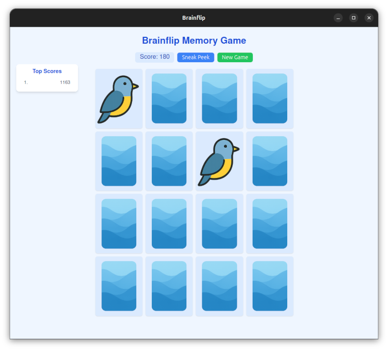

# Brainflip

Brainflip is a classic Concentration-style memory game. Players flip cards on a
4×4 grid to find matching pairs, testing their memory and concentration skills.

Brainflip now ships as a **native desktop application** built with
[Crumb](https://github.com/soyrochus/crumb). The interface is a self-contained
web page (HTML, CSS, TypeScript) that Crumb loads directly into the operating
system's WebView — there is no browser, no bundled Chromium, and no local web
server at runtime. The high-score list is persisted by a small trusted Bun
"host operation" instead of a REST backend.

The original Node.js (Express) and Python (Flask) web servers are still in the
repository so the game can also be played in a browser, but they are no longer
the primary way to run Brainflip.



---

## What changed: the migration to Crumb

Brainflip started life as a static `public/index.html` page served by an Express
(or Flask) process that also exposed a `/api/scores` JSON API backed by a text
file. That works in a browser but is awkward to distribute as an app.

Crumb keeps the web interface but removes the server. The table below summarises
the move.

| Area | Before (web app) | After (Crumb desktop app) |
| --- | --- | --- |
| Runtime | Browser + Node/Flask process on `localhost:8000` | Native OS WebView driven by a Bun host process; no server, no port |
| Interface | One `public/index.html` with inline `<script>` and inline `<style>` | `src/app/ui/{index.html,styles.css,app.ts}`, bundled by Bun into one document |
| Styling | Tailwind loaded from `cdn.tailwindcss.com` | Hand-written CSS in `src/app/ui/styles.css` (no CDN, no build step, CSP-safe) |
| Card images | Files served from `/images/*.png` | Embedded as `data:` URIs in `src/app/ui/assets.ts` (generated) |
| Score storage | `POST/GET /api/scores` → `server/storage/scores.txt` | `saveScore` / `loadScores` host operations → per-user data directory |
| Client ↔ server | `fetch('/api/scores')` | Typed, validated `invoke()` call over Crumb's message bridge |
| Distribution | "install Node, run the server, open a browser" | One standalone executable per platform (`bun run build`) |
| Security | Whatever the browser allows | Restrictive Content-Security-Policy: no network, no remote code, no navigation |

### Why the interface had to change

Crumb enforces a strict Content-Security-Policy and never runs a server, so a
few things in the old page could not survive unchanged:

- **The Tailwind CDN `<script>` is blocked.** All styling is now plain CSS with
  semantic class names.
- **`/images/...` cannot be fetched** (no server, `img-src data:` only). The
  eight card fronts plus the card back are inlined as base64 `data:` URIs.
- **`fetch('/api/scores')` has nowhere to go.** Score persistence is now a
  declared host operation: the page calls `invoke("saveScore", { score })`, the
  Bun host validates the input and writes the file.

### What did *not* change

The gameplay, scoring maths, animations (`flip`, `flop`, `backflip`),
accessibility behaviour, the "Sneak Peek" helper, and the debug layout are all
the same logic, ported from `public/index.html` into `src/app/ui/app.ts`.

---

## User guide

### How to play

1. **Start a game.** Launch the app (or run `bun run dev`). A 4×4 grid of
   face-down cards appears.
2. **Flip a card.** Click, tap, or focus a card and press `Enter` or `Space`.
3. **Find a match.** Flip a second card. A matching pair does a small
   celebratory "flop" and stays face-up; a mismatch does a dramatic "backflip"
   and turns back over.
4. **Score points.** Matches award points with bonuses for speed, streaks, and
   efficiency; mismatches cost a small penalty. Finishing quickly earns a time
   bonus.
5. **Win.** Match all eight pairs. Your final score, time, and accuracy are
   shown and the score is saved to the top-five list.
6. **Play again.** Use **Play Again** or the **New Game** button next to the
   score.

### Buttons next to the score

- **New Game** — restart immediately with a fresh shuffle.
- **Sneak Peek** — briefly reveals all face-down cards, then hides them again.
  Enabled by default; see [Sneak Peek](#sneak-peek-helper).

### Where your scores live

The top five scores are stored per user, outside the application bundle, so they
survive updates and moving the executable:

| Platform | Location |
| --- | --- |
| Linux | `$XDG_DATA_HOME/brainflip/scores.txt` (default `~/.local/share/brainflip/scores.txt`) |
| macOS | `~/Library/Application Support/brainflip/scores.txt` |

Delete that file to reset the leaderboard.

### Installing and running the desktop app

#### Requirements

- [Bun](https://bun.com/) 1.4 or newer.
- **Linux:** a native **Wayland** session with GTK 3 and WebKitGTK 4.1 (X11 and
  XWayland are not supported), plus a Rust toolchain via
  [rustup](https://rustup.rs/) — the first run compiles Crumb's pinned native
  WebView binding. See [`docs/build-and-runtime.md`](./docs/build-and-runtime.md)
  for the exact system packages.
- **macOS:** Apple Silicon, macOS 13 or newer. The system WebView is sufficient;
  no Rust toolchain is needed unless you add a native extension.

#### Run from source

```bash
bun install
bun run dev              # opens the game in a native window, watches sources
bun run dev --no-watch   # one-shot launch, no file watcher
```

`bun run dev` rebuilds the interface and restarts the window whenever you save a
file under `src/`. WebView developer tools are available in this mode only.

#### Build a standalone executable

Build on the OS you are targeting (Crumb does not cross-compile):

```bash
bun run build --target=linux-x64     # produces dist/brainflip-linux-x64
bun run build --target=macos-arm64   # produces dist/brainflip-macos-arm64
./dist/brainflip-linux-x64
```

The result is a single self-contained executable containing the Bun runtime,
the host code, and the embedded interface. It needs no adjacent files, no Bun or
Node installation, and no network access — only the operating system's own
WebView libraries.

---

## Developer guide

### Project layout

```text
src/app/                     The Brainflip application (yours to change)
├── app.config.ts            Window, CSP, UI entry points, operation table
├── host/handlers.ts         Trusted Bun-side code: loadScores / saveScore
├── shared/
│   ├── contracts.ts         Bridge types shared by page and host
│   └── validators.ts        Runtime validation of messages from the WebView
└── ui/
    ├── index.html           Document structure (dev CSP: script-src 'self')
    ├── styles.css           All styling (hand-written, no framework)
    ├── app.ts               Game logic
    └── assets.ts            Generated: card images as data: URIs

src/kit/                     Crumb template runtime — do not edit
app.config.ts                Application registry (default: "brainflip")
main.ts                      Entry point wired by Crumb
scripts/build-assets.ts      Regenerates src/app/ui/assets.ts from public/images/
scripts/                     Crumb build pipeline (dev, build, install:skills, …)
docs/                        Crumb's template documentation
test/kit/                    Tests for the Crumb kit
tests/                       Playwright end-to-end tests (legacy web server)
public/, server/, main.py    Legacy browser build and Express/Flask servers
```

`src/kit/` and `main.ts` belong to the Crumb template. A normal application
never modifies them. The full walkthrough is
[`docs/how-to-build-a-desktop-app-with-bun.md`](./docs/how-to-build-a-desktop-app-with-bun.md).

### How the page talks to the host

The page never touches the filesystem. It calls a **declared operation**, which
has four parts that must agree:

1. a shared type in `src/app/shared/contracts.ts` (`AppOperations`);
2. a runtime validator in `src/app/shared/validators.ts`;
3. a Bun handler in `src/app/host/handlers.ts`;
4. an entry in `operations` in `src/app/app.config.ts`.

Brainflip declares two:

| Operation | Input | Output | Handler does |
| --- | --- | --- | --- |
| `loadScores` | `{}` | `{ scores: number[] }` | reads the top-five file (empty list if absent) |
| `saveScore` | `{ score: number }` | `{ scores: number[] }` | validates `0 ≤ score ≤ 1_000_000`, merges, keeps top five, writes the file |

From the page:

```ts
import { invoke } from "../../kit/ui/bridge";
import type { AppOperations } from "../shared/contracts";

const { scores } = await invoke<AppOperations, "saveScore">("saveScore", { score: finalScore });
```

The validator is a security boundary, not a convenience — the host runs a
handler only after its validator accepts the raw message.

### The dual Content-Security-Policy

The CSP is declared twice and both must stay in sync:

- `src/app/ui/index.html` — `script-src 'self'; style-src 'self'` (used by
  `bun run dev`).
- `src/app/app.config.ts` — `script-src 'unsafe-inline'; style-src 'unsafe-inline'`
  (the release build inlines the script and stylesheet into one document).

Change one without the other and the app works in dev but breaks on release, or
silently loses a restriction.

### Card images

`src/app/ui/assets.ts` is generated from `public/images/*.png`. After changing
any card art, regenerate it:

```bash
bun run assets
```

It expects `front1.png`…`front8.png` and `back.png` and fails loudly if one is
missing.

### Sneak Peek helper

The "Sneak Peek" button briefly reveals all face-down cards, then hides them
again, without affecting your score, matched pairs, or current turn. It is
enabled by default. The switch and timing constants are at the top of
`src/app/ui/app.ts`:

```ts
const ENABLE_HELPERS = true;    // set false to remove the button entirely
const PEEK_DURATION_MS = 800;   // how long cards stay revealed
const PEEK_COOLDOWN_MS = 2000;  // cooldown between uses
```

The button auto-disables while a peek is running, during the cooldown, while a
pair is being compared, and once every card is matched. It supports keyboard and
screen-reader use.

### Debug layout

Running the game with `?debug=true` in the URL lays the deck out in order
(`A A B B …`) instead of shuffling. This is only reachable via the **legacy web
server** (`http://localhost:8000/?debug=true`); the desktop WebView loads the
document without a query string.

### Tests

```bash
bun test                 # Crumb kit + application unit tests (scoped to ./test)
bun run typecheck        # strict TypeScript check
npm run test:e2e         # Playwright end-to-end tests (see below)
```

`bun test` is scoped to `./test` so it does not pick up the Playwright specs
under `tests/`.

---

## Legacy web servers (optional)

The pre-Crumb servers still work and share the browser page at
`public/index.html` and the score file at `server/storage/scores.txt`.

### Node.js / Express

```bash
npm install
npm run dev:server     # nodemon, reloads on change
npm run start:server   # plain node
```

Open <http://localhost:8000>. Express serves `/public` and the JSON API lives at
`/api/scores`.

### Python / Flask

```bash
uv sync
source .venv/bin/activate   # or the Windows equivalent
python -m main.py
```

Both runtimes persist to the same `server/storage/scores.txt`, so you can switch
between them without losing data. Note that the Crumb desktop app uses a
**different**, per-user score file (see [Where your scores live](#where-your-scores-live)).

---

## Testing with Playwright

End-to-end tests drive the **legacy web server** and validate the core
card-matching mechanics across Chromium, Firefox, and WebKit. They inspect the
DOM for the `.flip` / `.matched` classes and the `data-image` attribute.

```bash
npm run test:e2e                       # or: npx playwright test
npx playwright test --ui               # interactive UI mode
npx playwright test --project=chromium # single browser
npx playwright show-report             # last HTML report
```

Playwright starts the Node.js server automatically before the run; see
[`playwright.config.ts`](./playwright.config.ts). The test suite lives in
`tests/card-matching.spec.ts`.

The Crumb interface in `src/app/` is not covered by these tests; its logic is
the same code ported from the web page.

---

## Model Context Protocol (MCP) Integration

The repository is set up to use MCP servers from VS Code with GitHub Copilot,
configured in `.vscode/mcp.json`:

1. **GitHub MCP** (`github`) — repositories, issues, pull requests, code search;
   `https://api.githubcopilot.com/mcp/`
2. **Atlassian MCP** (`atlassian-mcp`) — Jira / Confluence;
   `https://mcp.atlassian.com/v1/sse`
3. **Playwright MCP** (`playwright`) — browser automation and test generation;
   `npx @playwright/mcp@latest`

This enables AI-assisted test generation, browser debugging, and repository
context without leaving the IDE.

---

## Coding-assistant skills

Adopting Crumb installed a set of skills under `.claude/skills/`, `.codex/skills/`,
and `.github/skills/` (canonical copies live in `skills/`). They teach an
assistant Crumb's multi-file ceremonies — adding a host operation, adding a
native extension, adding a second application. Refresh the installed copies with:

```bash
bun run install:skills          # --check to verify, --list to preview
```

---

## Principles of Participation

Everyone is invited and welcome to contribute: open issues, propose pull
requests, share ideas, or help improve documentation. Participation is open to
all, regardless of background or viewpoint.

This project follows the [FOSS Pluralism Manifesto](./FOSS_PLURALISM_MANIFESTO.md),
which affirms respect for people, freedom to critique ideas, and space for
diverse perspectives.

## License and Copyright

Copyright © 2025, 2026 Iwan van der Kleijn

This project is licensed under the MIT License. See the [LICENSE](LICENSE) file
for details.
